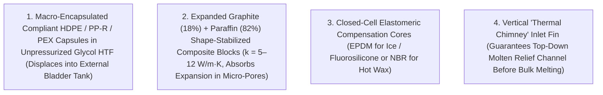

# PhaseBallast

**Marine Phase-Change Thermal Energy Storage (Hot Paraffin/Salt-Hydrate & Cold Ice/Eutectic Bilge Batteries)**

`phase-ballast` (**PhaseBallast**) is an engineering, materials science, and product development project for **solid $\leftrightarrow$ liquid phase-change thermal batteries** designed to store high-density heat (`55°C–75°C`) and cold (`-15°C` to `+7°C`) low in a vessel's bilge or under-settee compartments.

---

## Why PhaseBallast?

Thermal loads—domestic hot water, cabin heating, air conditioning, and refrigeration—account for `60%–75%` of total energy consumption aboard a cruising yacht:
* Storing `1 kWh` of electricity in marine `LiFePO4` batteries costs **`$250–$600/kWh`** (`~8–10 kg`), whereas storing `1 kWh_th` of latent heat/cold in a phase-change material (PCM) costs **`$8–$45/kWh_th`** in raw materials.
* **Hot Battery (`58°C–65°C` Paraffin Wax or Sodium Acetate Trihydrate):** Charges from `HelioStrake` PV/T solar deck panels, diesel engine jacket/exhaust waste heat, or a single clean `100%` high-fire run of a diesel hydronic heater—providing instant tankless domestic hot water and silent overnight cabin heating without heater short-cycling or carbon soot buildup.
* **Cold / Ice Battery (`0°C` Ice or `+6°C` Bio-Ester / Tetradecane):** Charges during peak daytime solar (`10:00–16:00`) using a variable-speed DC heat pump pre-cooled by seawater or evaporative cooling (`COP 3.5–5.0`), allowing the compressor to shut off completely at sunset while cooling sleeping cabins silently overnight on a **`10 W` circulation pump**.

---

## Solving Volumetric Expansion & Contraction ($\Delta V$)

Water (`+9.0%` expansion when **freezing**) and paraffin wax (`+10% to +14%` expansion when **melting**) expand in opposite directions and destroy conventional rigid tanks via **ice bridging** or **solid-crust hydraulic lockup**. `PhaseBallast` solves phase-transition volume changes using four engineered architectures:

---

## Repository Contents

* **[`pcm-thermal-ice-battery-guide.md`](pcm-thermal-ice-battery-guide.md)** — Complete engineering guide covering hot/cold PCM selection matrices, expansion/contraction physics, 5 expansion-compensation architectures, evaporative-precooled heat pump charging topologies, `40-ft` yacht sizing calculations, DIY build blueprints, and commercial modular brick specifications.

---

## Development Roadmap

- [x] **Phase 0: Thermodynamics & Expansion Architecture Specification**
  - Benchmark hot PCMs (paraffin, fatty acids, sodium acetate trihydrate, expanded-graphite composites) and cold PCMs (water/ice, `+6°C` `n-tetradecane`/bio-esters, sub-zero eutectics).
  - Define mechanical expansion-relief architectures for `0°–45°` marine heel angles.
- [ ] **Phase 1: Benchtop Expansion & Thermal Cycling Prototypes (`0.5 kWh_th` Coupons)**
  - Build and cycle-test (`100` freeze-melt cycles) a macro-encapsulated `PP-R` tube cartridge array and an Expanded Graphite + `60°C` Paraffin composite block.
  - Validate External-Melt Ice-on-Coil freeze thickness sensor and `EPDM` closed-cell compensation cores.
- [ ] **Phase 2: Full-Scale `3.0 kWh_th` Hot & `4.0 kWh_th` Cold Bilge Prototypes**
  - Integrate hot battery with diesel engine heat exchanger, hydronic heater, and `HelioStrake` solar thermal loop.
  - Integrate cold battery with evaporative/seawater-precooled DC heat pump and cabin fan-coils.
