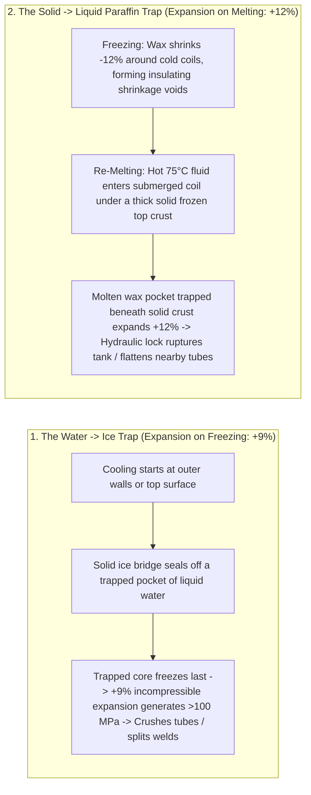
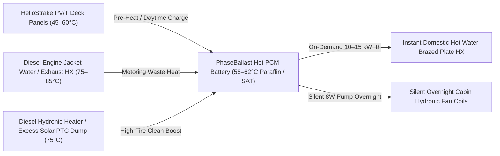
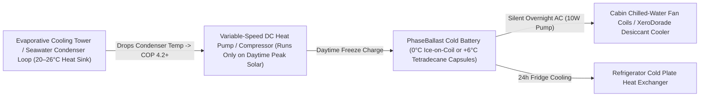

# Marine Phase-Change Thermal Energy Storage (Heat & Cold Batteries): Engineering, Expansion Physics & Production Guide

**PhaseBallast** (`phase-ballast`) explores the engineering, materials science, DIY fabrication, and commercial manufacturing of **marine phase-change thermal energy storage (TES) batteries**—storing high-density latent heat (`55°C–75°C`) or latent cold (`-15°C` to `+7°C`) inside low-profile bilge, keel, and under-settee compartments.

---

## 1. Why Phase-Change Thermal Batteries on a Boat?

On a cruising yacht or hybrid-electric vessel, thermal loads (domestic hot water, cabin heating, cabin air conditioning, and refrigeration) account for **`60%–75%` of total daily energy consumption**:
* **Storing Electricity in LiFePO4 vs. Storing Latent Heat/Cold in PCM:**
  * `1 kWh` of marine `LiFePO4` battery capacity costs **`$250–$600/kWh`** and weighs `~8–10 kg`.
  * `1 kWh` of latent thermal storage (paraffin wax, salt hydrate, or water/ice) costs **`$8–$45/kWh_th`** in raw materials and can be charged directly from **"free" thermal sources** (`HelioStrake` PV/T deck panels, diesel engine jacket water/exhaust waste heat) or from **daytime surplus solar electricity boosted by `3.5–5.0×` through a high-COP seawater/evaporative-cooled heat pump**.
* **Eliminating Nighttime Noise & Short-Cycling:**
  * **Hot Battery:** Running a diesel hydronic heater (`Webasto`/`Espar`) at low output overnight fouls the glow-pin with carbon soot and drains DC power on glow/fan cycles. Running it at `100%` clean high-fire for `45 minutes` (or capturing 1 hour of motoring waste heat) charges a `3–5 kWh_th` paraffin/salt-hydrate battery that delivers silent instant hot water and cabin heat all night.
  * **Cold / Ice Battery:** Daytime solar output peaks between `10:00` and `16:00`, while cabin air-conditioning demand continues through humid tropical nights. Freezing an ice or `+6°C` eutectic cold battery during peak afternoon sun using an evaporative/seawater-precooled heat pump lets you shut the compressor off completely at sunset and cool the sleeping cabins silently overnight using only a **`10 W` circulation pump** and a **`12 W` fan coil**.

---

## 2. Phase-Change Materials (PCM) Selection Matrix: Hot vs. Cold

### A. Hot-Side PCM Candidates (`52°C – 72°C` for Domestic Hot Water & Hydronic Heating)

| PCM Material | Melt Temp ($T_m$) | Latent Heat ($\Delta H_f$) | Volumetric Latent Density | Volume Change ($\Delta V$ Solid $\rightarrow$ Liquid) | Thermal Cond. ($k_{\text{solid}}$) | Key Pros & Marine Caveats |
| :--- | :--- | :--- | :--- | :--- | :--- | :--- |
| **Refined Paraffin Wax** (*n-alkanes `C24–C30`*, `Rubitherm RT58/RT64HC`, or fully refined `58–62°C` wax) | `54°C – 68°C` | `200 – 240 kJ/kg` | `~170 – 195 kJ/L` (`47–54 Wh_th/L`) | **`+10% to +14%` expansion on melting** | `0.20 W/m·K` | **Best for DIY & Long Life:** Zero supercooling, non-corrosive to all metals/plastics, infinite freeze-melt cycles, chemically inert. **Caveats:** Low thermal conductivity; combustible above flash point (`>210°C`, so keep below `90°C` water loops); large `+12%` melt expansion. |
| **Expanded Graphite + Paraffin Composite (`SS-PCM`)** (`82 wt%` Paraffin + `18 wt%` Expanded Graphite) | `54°C – 68°C` | `165 – 195 kJ/kg` | `~150 – 175 kJ/L` (`42–48 Wh_th/L`) | **`<1.5%` macroscopic** (absorbed in pores) | **`5.0 – 12.0 W/m·K`** (`30–50×` faster!) | **Best for Commercial Product:** Macroscopically form-stable (no liquid sloshing on a heeling boat!), ultra-fast heat transfer without dense metal fin packs, absorbs expansion inside micro-pores, flame-retardant additives easily compounded. |
| **Bio-Fatty Acids** (*Palmitic Acid*, *Stearic Acid*, or Eutectics) | `55°C – 67°C` | `190 – 215 kJ/kg` | `~170 – 185 kJ/L` (`47–51 Wh_th/L`) | **`+8% to +10%` expansion on melting** | `0.18 W/m·K` | Bio-derived, inexpensive (`$2.50–$4/kg`), sharp melting point, slightly lower expansion than paraffin. Mildly acidic—use stainless `316L`, copper, or `HDPE`/`PP`/`PEX` containment. |
| **Sodium Acetate Trihydrate (`SAT`)** (`NaCH3COO·3H2O` + `1.5% DSP` nucleator + `1.5% CMC`) | **`58.0°C`** | **`264 kJ/kg`** | **`~380 kJ/L` (`105 Wh_th/L`)** | **`+3.5%` expansion on melting** | `0.60 W/m·K` (`3×` paraffin) | **Highest Volumetric Density (`2×` Paraffin) & Non-Flammable:** Stores `1 kWh_th` in under `10 Liters`! Food-grade vinegar salt (reusable hand-warmer chemistry). **Caveat:** Must be compounded with a nucleating agent (`disodium phosphate`) and thickener (`CMC`/xanthan) in sealed capsules to prevent supercooling and phase separation. |

---

### B. Cold-Side PCM Candidates (`-15°C` to `+7°C` for Cabin AC & Refrigeration)

| PCM Material | Freeze Temp ($T_f$) | Latent Heat ($\Delta H_f$) | Volumetric Latent Density | Volume Change ($\Delta V$ Liquid $\rightarrow$ Solid) | Chiller Evaporator Temp & COP Impact | Best Marine Application |
| :--- | :--- | :--- | :--- | :--- | :--- | :--- |
| **Pure Water / Ice (`H2O`)** | **`0.0°C`** | **`334 kJ/kg`** | **`306 kJ/L` (`85 Wh_th/L`)** | **`+9.0%` EXPANSION on freezing** | Evap @ `-5°C to -7°C` (`COP ≈ 2.8–3.4` with seawater/evap precooling) | **Best All-Around DIY & High-Capacity Cold Battery:** Free, non-toxic, highest latent heat on earth, high thermal conductivity of solid ice (`2.2 W/m·K` = `11×` higher than paraffin!). Requires strict `+9%` freeze-expansion engineering. |
| **`n-Tetradecane` (`C14H30`) or Lauric/Caprylic Bio-Ester** | **`+5.8°C to +7.5°C`** | `210 – 228 kJ/kg` | `~165 – 178 kJ/L` (`46–50 Wh_th/L`) | **`-9%` CONTRACTION on freezing** (Never bursts tanks on freeze!) | Evap @ `+1°C to +3°C` (**`COP ≈ 4.2–5.2`** — `+35%` more efficient than ice!) | **Best for Dedicated Cabin Air-Conditioning Buffer:** Freezes right at chilled-water AC supply temp (`+6°C`), avoiding sub-zero compressor efficiency penalties, and shrinks rather than expands when frozen! |
| **Aqueous Salt / Glycol Eutectic (`-10°C` to `-18°C`)** (`12–20% NaCl/CaCl2` or `KCl` + `Propylene Glycol` + nucleator) | **`-10°C to -18°C`** | `220 – 285 kJ/kg` | `~240 – 295 kJ/L` (`66–82 Wh_th/L`) | **`+5% to +7%` expansion on freezing** | Evap @ `-16°C to -24°C` (`COP ≈ 1.8–2.3`) | **Refrigerator & Deep-Freeze Holdover:** Replaces expensive dedicated marine holding-plate compressors with a central cold loop. |

---

## 3. Solving the #1 Failure Mode: Volumetric Expansion & Contraction ($\Delta V$)

Water (`+9%` expansion when **freezing**) and paraffin wax (`+10% to +14%` expansion when **melting**) expand in **opposite phase directions** and destroy poorly designed tanks via two distinct mechanical mechanisms:

### 5 Proven Engineering Architectures to Eliminate Expansion Damage

#### Architecture 1: Macro-Encapsulated Compliant Capsules / Dimple-Plates Submerged in Atmospheric HTF (Best All-Around Architecture for Both DIY & Commercial Products)
Instead of filling a large tank with bulk wax or bulk ice and running fragile metal coils through it, **invert the containment**:
* **How it works:**
  1. Seal the PCM (paraffin wax, `SAT` salt hydrate, or water/ice) inside modular **blow-molded `HDPE` / `PP-R` flat dimple-plates (`15–25 mm` thick)**, **`PEX-a` / `PP` sealed tubes (`32–50 mm` OD)**, or **spherical `HDPE` balls (`40–60 mm` diameter)** with a `12%` internal compressible gas pillow.
  2. Pack the sealed PCM capsules/plates inside an insulated `HDPE` or fiberglass bilge tank.
  3. Fill the void space *around* the capsules (`~25%–35%` of tank volume) with your circulating **Heat Transfer Fluid (`HTF` — 30% USP Propylene Glycol + Water)**.
* **How Expansion is Completely Solved:**
  * Every individual `HDPE`/`PEX-a` capsule has thin (`1.0–1.5 mm`), elastically compliant polymer walls. When paraffin melts (`+12%`) or ice freezes (`+9%`) inside a capsule, the polymer wall flexes outward by less than `1 mm`.
  * That slight outward flex simply displaces an equal volume of liquid propylene-glycol HTF out of the unpressurized tank into a standard **`$35` hydronic EPDM diaphragm expansion tank** (or atmospheric overflow reservoir) mounted in the plumbing loop!
* **Massive Secondary Advantage — Huge Heat Transfer Area Without Metal Fins:**
  * Because the glycol HTF flows directly through the narrow `3–5 mm` channels between dozens of thin flat PCM plates or tubes, the wetted heat-exchange surface area is **`120 to 250 m² per m³` of tank volume**—completely eliminating expensive copper/aluminum coil fabrication and solving paraffin's low thermal conductivity (`max conduction path is only 7–10 mm` from capsule wall to center!).

#### Architecture 2: Distributed Closed-Cell Elastomeric Compensation Cores (`EPDM` / `Fluorosilicone` Sponge Mandrels)
If you build a traditional **shell-and-tube** tank (HTF inside copper/stainless/PEX tubes, bulk PCM filling the tank shell):
* **How it works:**
  * Place closed-cell, nitrogen-blown **compressible elastomer foam rods or sheets** (`12%–15%` of total internal tank volume, compression deflection `35–70 kPa` / `5–10 PSI`) directly alongside the heat-exchanger tubes and lining the tank walls.
  * *Material Selection:*
    * **For Ice / Salt Brine Tanks (`-20°C to +30°C`):** Closed-cell **EPDM sponge rubber** or **cross-linked polyethylene (`XLPE`) closed-cell foam**.
    * **For Hot Paraffin Wax (`20°C to 85°C`):** Standard EPDM and neoprene swell in hot liquid hydrocarbons! Use **closed-cell Fluorosilicone (`FVMQ`)**, **Nitrile (`Buna-N` / `NBR`) closed-cell sponge**, or **thin-wall sealed corrugated `316L` stainless / `PTFE` gas-filled bellows tubes**.
* **Why it works at any boat heel angle (`0°–45°`):** Even when the boat is heeled `30°` on a tack and a solid crust traps melting wax or freezing ice at the bottom of the tank, the adjacent closed-cell elastomer compresses locally right at the phase front, preventing pressure spikes above `0.7 bar` (`10 PSI`).

#### Architecture 3: The "Thermal Chimney" (Directional Top-Down Melting Fin for Bulk Paraffin Tanks)
If using bulk paraffin wax in a shell-and-tube tank with a `15%` top air/nitrogen ullage headspace:
* **The Rule:** Hot incoming coolant (`75°C–85°C`) must **never** enter the bottom of the frozen wax tank first.
* **How it works:**
  * Route the hot HTF inlet pipe straight through the top headspace and vertically down one side of the tank before feeding the bottom heat-exchanger coil.
  * Attach two wide **longitudinal aluminum (`6061`) or copper plate fins** to that vertical down-comer pipe, extending continuously from `20 mm` *above* the frozen wax surface all the way to the bottom of the tank.
  * Within `60 seconds` of hot water flowing, the vertical fin melts a continuous liquid slot (**pressure-relief chimney**) from the top headspace down to the bottom coil. As the main bulk melts from the bottom up, expanding liquid wax (`+12%`) escapes freely up the molten chimney onto the top surface without ever getting trapped beneath a solid bridge.

#### Architecture 4: Expanded Graphite + Paraffin Shape-Stabilized Blocks (`EG/PCM` — Commercial Product Gold Standard)
For a commercial marine heat battery product:
* **How it works:**
  * Compress exfoliated **Expanded Graphite (`EG`)** worms into porous conductive blocks (`bulk density ~160 kg/m³`, `82%` open porosity) with milled grooves for copper, `316L` stainless, or `PEX` fluid tubes.
  * Immerse the blocks in molten paraffin under vacuum so capillary action draws `80–83 wt%` paraffin into the microscopic graphite pores.
* **Why it transforms the product:**
  1. **Internal Micro-Pore Expansion Absorption:** Leaving `10%–12%` residual micro-void volume inside the graphite matrix absorbs the entire solid $\leftrightarrow$ liquid volume change internally—the outer block dimensions change by `<0.5%`.
  2. **Zero Liquid Sloshing at Sea:** Even at `80°C` (when the paraffin is 100% liquid), capillary surface tension inside the `10–40 µm` graphite pores holds the wax like a dry solid brick—you can turn the block upside down or heel the boat `45°` with zero leakage or free-surface sloshing.
  3. **`30×` Higher Thermal Conductivity (`5–10 W/m·K`):** Eliminates the "insulating solid wax crust" bottleneck during discharge, allowing instant `10–15 kW` thermal discharge bursts for on-demand hot showers!

#### Architecture 5: External-Melt Ice-on-Coil with Electronic Ice-Bridge Limiting (For Pure Water Cold Batteries)
* When freezing pure water on submerged evaporator coils, ice grows radially outward around each tube (`External Melt Ice-on-Coil`).
* So long as adjacent ice cylinders leave at least a **`6–10 mm` open water gap** between tubes (`~65%–70%` ice fraction, `30%–35%` liquid water) and the water level has a `10%` free headspace at the top of the tank (with a tapered or `EPDM`-foam-lined top perimeter so surface ice slides upward as it freezes), **freezing expansion (`+9%`) simply raises the free water level by `6%`** with zero structural stress!
* Use a simple **`$5` stainless conductivity probe or NTC thermistor** placed `18 mm` away from the evaporator tube: as soon as the growing ice front touches the sensor (`resistance jumps 100×` as liquid water transitions to solid ice), the controller stops the freeze cycle—guaranteeing the tank never freezes into a solid monolithic block.

---

## 4. Integrated System Topologies (Charging & Discharging)

### A. Hot Battery System Topology (`58°C–65°C` Paraffin / SAT Battery)

### B. Cold / Ice Battery System Topology (Evaporative + Seawater Precooled Heat Pump $\rightarrow$ `0°C` Ice or `+6°C` PCM)

* **Why Combine Evaporative Cooling + Heat Pump to Make Ice / Cold?**
  * In a hot anchorage (`34°C` air, `29°C` surface seawater in the tropics), a standard air-cooled or surface-water-cooled refrigeration condenser runs at `42°C–50°C` condensing temperature, dragging the heat pump's Coefficient of Performance (`COP`) down to `1.8–2.2`.
  * By pre-cooling the condenser water loop via an **indirect/direct evaporative cooling stage** (particularly when paired with dehumidified exhaust air from the cabin or `XeroDorade` unit, where the wet-bulb temperature is `18°C–22°C`), the heat-pump condenser operates at **`24°C–27°C`**.
  * Dropping the temperature lift ($\Delta T_{\text{lift}} = T_{\text{cond}} - T_{\text{evap}}$) from `50 K` down to `27 K` nearly **doubles the compressor's `COP`**—allowing `600 W` of daytime solar power to store **`2.0–2.5 kWh_th` of ice cooling** per hour!

---

## 5. Sizing & Blueprint: DIY vs. Commercial Product

### A. Real-World Sizing for a `40-Foot` Cruising Yacht
1. **Hot Water & Cabin Heating Battery (`3.0 kWh_th` / `10.8 MJ` Effective Capacity):**
   * Combining latent heat (`~210 kJ/kg` at `58°C–62°C`) + sensible heat (`45°C to 75°C`, $\Delta T = 30\text{ K}$ at $c_p \approx 2.2\text{ kJ/kg·K} \implies +66\text{ kJ/kg}$) yields **`~275 kJ/kg`** (`76 Wh_th/kg`) of usable thermal storage.
   * **`40 kg` (`~48 Liters` of wax + `18 Liters` of glycol HTF = `66 L` total internal volume)** stores **`3.04 kWh_th`**: enough to heat **`85 Liters` of shower/galley water from `20°C` to `50°C`** with zero engine or heater runtime!
   * *(Using **Sodium Acetate Trihydrate `SAT`** capsules, the same `3.0 kWh_th` battery shrinks to just **`32 Liters` total volume** and `42 kg`!).*
2. **Overnight Sleeping Cabin Cold Battery (`4.0 kWh_th` / `14.4 MJ` Effective Capacity):**
   * Combining latent heat of ice (`334 kJ/kg` at `0°C`) + sensible warming of melted water from `0°C` to `10°C` (`+42 kJ/kg`) yields **`376 kJ/kg`** (`104 Wh_th/kg`).
   * **`38 kg` of ice (`~42 Liters` of ice + `18 Liters` buffer water = `60 L` insulated bilge tank)** stores **`4.0 kWh_th`** of cooling—delivering **`500 W_th` of silent dehumidifying cabin cooling for `8 hours` overnight** while drawing only **`20 W` of DC electrical power** (`160 Wh` total overnight battery draw vs `3,500–5,000 Wh` for a traditional marine AC!).

---

### B. DIY Build Blueprint (`3.0 kWh_th` Modular Bilge PCM Battery — Est. Cost `$280 – $450`)

1. **Tank Enclosure:**
   * Rotomolded `HDPE` marine water tank (`60–75 L` with a large `150 mm` / `6"` bolted inspection deck plate on top) wrapped in `25 mm` closed-cell `Armaflex` elastomeric insulation (`Hot` or `Cold` service) or `PIR` polyisocyanurate foam board.
2. **Macro-Encapsulated PCM Cartridges (Zero-Weld, Zero-Rupture DIY Method):**
   * Purchase `32 mm` (`1-1/4"`) or `40 mm` (`1-1/2"`) **thin-wall `PP-R` or `PEX-a` tubing** cut into `450 mm` lengths (or heavy-duty blow-molded `HDPE` flat bottles/cylinders).
   * **For Hot Battery:** Fill each tube to **`86%` volume** with molten **`58°C–62°C` fully refined paraffin wax** (doped with `5 wt%` micronized graphite powder stirred in before solidification to double internal conductivity), leaving `14%` air headspace, and socket-fusion weld `PP-R` end caps onto both ends.
   * **For Cold Battery:** Fill each tube to **`88%` volume** with distilled water + `0.5%` food-grade propylene glycol (prevents hard crystalline lockup) + a central `6 mm` strip of closed-cell `EPDM` sponge foam running down the axis of the tube, and fusion-weld the end caps.
3. **Assembly & Plumbing:**
   * Pack `60–80` sealed PCM tubes into the `HDPE` tank (use two perforated `HDPE` baffle plates to ensure even fluid distribution from bottom inlet to top outlet).
   * Circulate your boat's closed `30%` propylene-glycol hydronic loop directly through the tank shell around the outside of the sealed tubes, with a standard `2-gallon` (`8 L`) `Amtrol` / `Jabsco` hydronic expansion bladder tank teed into the loop.

---

### C. Commercial Product Architecture (`PhaseBallast` Modular Marine Thermal Bricks)

To manufacture `PhaseBallast` as a commercial marine product that drops into irregular bilge/settee spaces:
1. **Modular `1.0 kWh_th` Interlocking Composite Bricks (`400 × 250 × 120 mm`, `~12 Liters` per module):**
   * Rotational-molded or twin-sheet thermoformed **`HDPE` / `PP` outer structural shell** with integrated **`20 mm` Vacuum Insulation Panels (`VIPs`, $k = 0.004\text{ W/m·K}$, `10×` better than foam, `<1.5%` heat loss per 24 hours)** encapsulated inside the double wall.
2. **Internal Core Options (Hot vs. Cold SKU):**
   * **`PhaseBallast-Hot60` SKU:** Vacuum-impregnated **Expanded Graphite (`18%`) + `60°C` Paraffin (`82%`) form-stable core** pressed directly over a serpentine **`316L` stainless steel or copper multi-pass finned tube heat exchanger** (`k_effective = 8 W/m·K`, capable of `8 kW_th` peak discharge per brick for instant tankless shower heating, zero liquid sloshing, internal micro-pore expansion absorption).
   * **`PhaseBallast-Cold06` / `Cold00` SKU:** Ultrasonic-welded stack of **thin-wall (`0.8 mm`) blow-molded `HDPE` dimpled plates** filled with `+6°C` bio-ester PCM (for high-COP cabin AC) or nucleated `0°C` water/glycol with internal elastomeric expansion pillows, separated by `2.5 mm` turbulent glycol flow channels.
3. **Snap-Fit Parallel/Series Manifold Rail:**
   * Quick-connect `EPDM`-O-ring push-lock manifolds (`22 mm` ports) allow boat owners or yards to click `2, 4, or 6` bricks together along the centerline bilge like Lego blocks—turning dead bilge space into **productive thermal ballast** right at the boat's lowest center of gravity.
